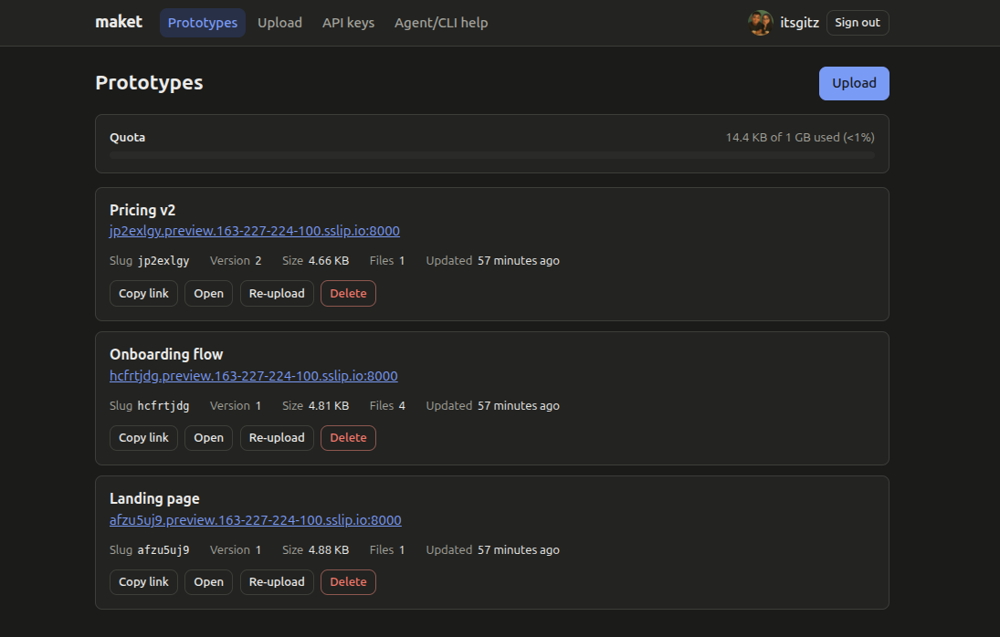

# maket

[](https://github.com/itsgitz/maket/releases)
[](LICENSE)



Self-hosted host for static frontend prototypes. Upload an `.html` file or a `.zip` of a build, and get a Preview URL. People use the web dashboard; AI agents use the `maket` CLI or plain HTTP with an API Key.

## Features

- **GitHub sign-in with an Allowlist.** Only the GitHub usernames you list in `MAKET_ALLOWED_GITHUB_USERS` can sign in or use the API.
- **Previews on their own subdomain.** Each Prototype is served at `<slug>.<preview domain>`, with optional SPA mode for client-side routing.
- **Re-Upload keeps the URL.** A new Version replaces the old one at the same Preview URL, so links you already shared keep working.
- **API Keys and a CLI with `--json`.** Agents get a stable JSON output and exit codes from `maket`, or can call the HTTP API directly.
- **Quota and storage choice.** Each User has a Quota. Files live on local disk or in an S3-compatible bucket (Cloudflare R2, MinIO).
- **One Go binary.** The dashboard is embedded in the server, and production runs as a rootless Podman pod.

## Quickstart for agents

```sh
curl -fsSL https://raw.githubusercontent.com/itsgitz/maket/main/install.sh | sh
maket login        # paste an API Key created in the dashboard
URL=$(maket push ./dist)
```

Set `MAKET_API_KEY` (and `MAKET_API_URL` for a non-default server) instead of running `maket login` in CI or a sandbox. See [`docs/cli.md`](docs/cli.md) for every command and flag.

## Documentation

- [`docs/cli.md`](docs/cli.md): install, sign in and the `maket` commands
- [`docs/api.md`](docs/api.md): the HTTP API, errors and limits
- [`docs/deploy.md`](docs/deploy.md): running your own server
- [`CONTRIBUTING.md`](CONTRIBUTING.md): development setup, checks and how to send changes

See `docs/maket-build-brief.md` for the full design, `GLOSSARY.md` for vocabulary, and `docs/adr/` for decisions.

## Layout

- `apps/api`: Go module. The server (`cmd/server`) serves the JSON API, the embedded dashboard and Previews, routed by `Host` header. The CLI lives in `cmd/maket`; see [`docs/cli.md`](docs/cli.md) for install and usage. Released CLI binaries are on the [Releases page](https://github.com/itsgitz/maket/releases).
- `apps/web`: Vite + Svelte 5 dashboard, built into `apps/api/internal/webui/dist` and embedded in the server binary.

## Requirements

- Go (see `apps/api/go.mod`)
- Bun
- Optional: [`air`](https://github.com/air-verse/air) for Go hot reload (`go install github.com/air-verse/air@latest`)

## Development

```sh
bun install
cp .env.example .env
bun run dev
```

To sign in locally, create a GitHub OAuth app (GitHub → Settings → Developer settings → OAuth Apps) with callback URL `http://app.localhost:5173/api/auth/github/callback`, put its client ID and secret in `.env`, and list your GitHub username in `MAKET_ALLOWED_GITHUB_USERS`.

Open http://app.localhost:5173. Vite serves the dashboard and proxies `/api` to the Go server on `:8080`, keeping the `Host` header so host routing works. Previews are served by Go directly at `http://<slug>.preview.localhost:8080`. Modern browsers resolve `*.localhost` to your machine, so no `/etc/hosts` edits are needed.

## Scripts

| Script | What it does |
|---|---|
| `bun run dev` | Vite dev server + Go server together |
| `bun run build` | `build:web` then `build:api` |
| `bun run build:web` | Builds the dashboard into `apps/api/internal/webui/dist` |
| `bun run build:api` | Builds `bin/maket-server` (static, no CGO) |
| `bun run build:cli` | Cross-compiles `bin/maket-<os>-<arch>` for linux, darwin, windows on amd64 and arm64 |
| `bun run test` | Go tests + dashboard type check |

The CLI is published to [GitHub Releases](https://github.com/itsgitz/maket/releases) by CI; see [Releasing](#releasing).

## Deployment

Production runs on one VPS with rootless Podman, Caddy and the maket server in one Quadlet-managed pod, with nightly restic backups to Cloudflare R2. See [`docs/deploy.md`](docs/deploy.md).

## Configuration

All settings come from `MAKET_*` environment variables; see `.env.example`. The server exits at startup with a list of every missing or invalid setting.

## Releasing

Push a version tag such as `v0.1.0`. The `release` workflow runs the Go tests, cross-compiles the CLI, writes `checksums.txt` and publishes a GitHub Release with the binaries attached.

```sh
git tag v0.1.0
git push origin v0.1.0
```

## License

maket is released under the [MIT License](LICENSE).
